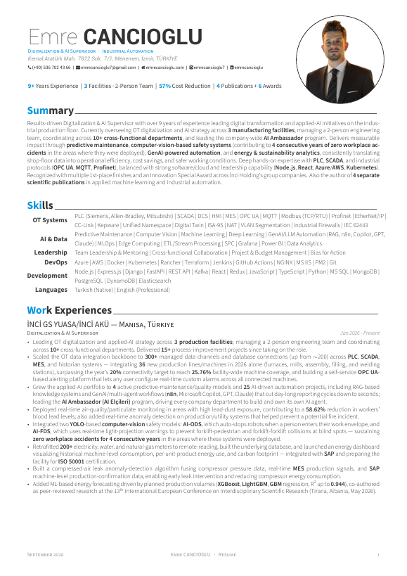
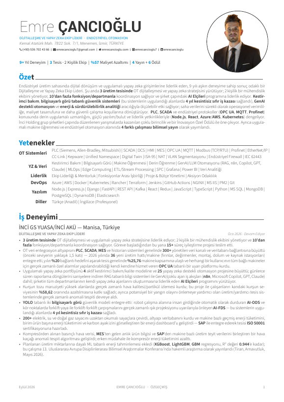
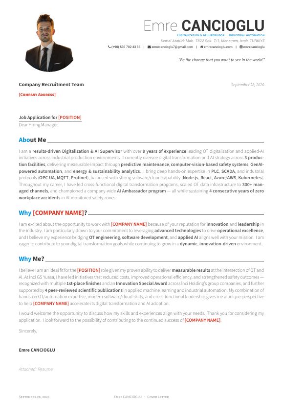
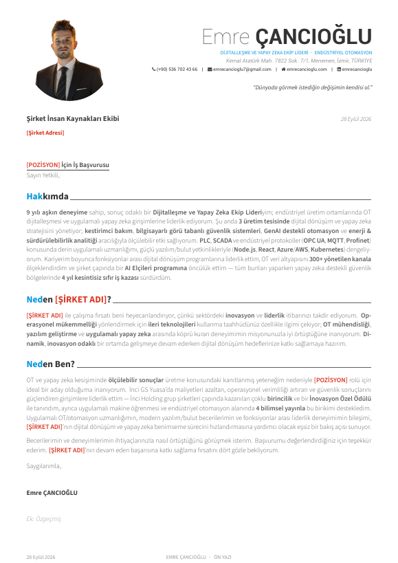

<div align="center">



**🇬🇧 English** · [🇹🇷 Türkçe](#-türkçe)


</div>


## 🇬🇧 English

A bilingual (EN / TR) **résumé and cover-letter** set built with LaTeX and the [Awesome-CV](https://github.com/posquit0/Awesome-CV) class. Content lives in small per-section files, so updating a single bullet point never means touching layout code.

### 📄 Documents

| Document | English | Türkçe |
|---|---|---|
| Résumé (3 pages) | [`resume.pdf`](resume.pdf) · [`resume.tex`](resume.tex) | [`resume_tr.pdf`](resume_tr.pdf) · [`resume_tr.tex`](resume_tr.tex) |
| Cover letter (1 page) | [`coverletter.pdf`](coverletter.pdf) · [`coverletter.tex`](coverletter.tex) | [`coverletter_tr.pdf`](coverletter_tr.pdf) · [`coverletter_tr.tex`](coverletter_tr.tex) |

### 👀 Preview

<table>
  <tr>
    <td align="center"><b>Résumé · EN</b><br/><a href="resume.pdf"></a></td>
    <td align="center"><b>Résumé · TR</b><br/><a href="resume_tr.pdf"></a></td>
  </tr>
  <tr>
    <td align="center"><b>Cover letter · EN</b><br/><a href="coverletter.pdf"></a></td>
    <td align="center"><b>Cover letter · TR</b><br/><a href="coverletter_tr.pdf"></a></td>
  </tr>
</table>

### 🗂 Repository structure

```text
├── resume.tex / resume_tr.tex              # entry points (EN / TR)
├── resume/        resume_tr/               # one file per section
│   ├── summary.tex  skills.tex  experience.tex
│   └── honors.tex  presentation.tex  certification.tex  education.tex
├── coverletter.tex / coverletter_tr.tex    # cover-letter templates (EN / TR)
├── awesome-cv.cls                          # template class (not modified)
├── fonts/                                  # Source Sans 3, Roboto, FontAwesome
└── assets/                                 # README graphics
```

### 🔧 Build

XeTeX is required (custom fonts). Compile **twice** so references resolve:

```sh
xelatex resume.tex      && xelatex resume.tex
xelatex resume_tr.tex   && xelatex resume_tr.tex
xelatex coverletter.tex && xelatex coverletter.tex
xelatex coverletter_tr.tex && xelatex coverletter_tr.tex
```

Or open the folder on [Overleaf](https://www.overleaf.com) and set the compiler to **XeLaTeX**.

> Personal images (`photo.png`, `ECANCIOGLU.png`) are git-ignored. Put your own `photo.png` next to the `.tex` files before compiling.

### ✍️ Using the cover letter as a template

Everything that must change per application is highlighted in **bold red** in the PDF:

| Placeholder | Where |
|---|---|
| `[Company Address]` / `[Şirket Adresi]` | recipient block |
| `[POSITION]` / `[POZİSYON]` | letter title, “Why Me?” section |
| `[COMPANY NAME]` / `[ŞİRKET ADI]` | “Why …?” heading and body |

Fill these in, recompile, and the red disappears only when the placeholders do. The `\ph{...}` macro (top of each cover-letter file) controls the highlight. To send a final version without red, replace its definition with `\newcommand{\ph}[1]{#1}`.

### 🇹🇷 Turkish typesetting note

The class renders some headings in small caps, which drops the dot of Turkish **İ**. The TR files override those styles and hand-type affected headings in dotted upper case (`DİJİTALLEŞME`, `MÜHENDİSİ`, …). Keep that in mind when adding new headings to Turkish files.

### 💡 Tips for bullet points

- Structure: **“Accomplished [X] as measured by [Y] by doing [Z].”**
- Start with strong verbs, keep every bullet to one or two lines, and avoid a last line with only one or two words.
- Only claim numbers you can source; scope team results as team results.


## 🇹🇷 Türkçe

**LaTeX** ve [Awesome-CV](https://github.com/posquit0/Awesome-CV) sınıfıyla hazırlanmış, iki dilli (TR / EN) **özgeçmiş ve ön yazı** seti. İçerik bölüm bölüm ayrı dosyalarda tutulur; tek bir maddeyi güncellemek için düzen koduna dokunmak gerekmez.

### 📄 Belgeler

| Belge | Türkçe | English |
|---|---|---|
| Özgeçmiş (3 sayfa) | [`resume_tr.pdf`](resume_tr.pdf) · [`resume_tr.tex`](resume_tr.tex) | [`resume.pdf`](resume.pdf) · [`resume.tex`](resume.tex) |
| Ön yazı (1 sayfa) | [`coverletter_tr.pdf`](coverletter_tr.pdf) · [`coverletter_tr.tex`](coverletter_tr.tex) | [`coverletter.pdf`](coverletter.pdf) · [`coverletter.tex`](coverletter.tex) |

Önizlemeler yukarıdaki **Preview** bölümündedir.

### 🔧 Derleme

Özel yazı tipleri nedeniyle **XeLaTeX** gerekir. Çapraz başvuruların oturması için her dosyayı **iki kez** derleyin:

```sh
xelatex resume_tr.tex && xelatex resume_tr.tex
xelatex coverletter_tr.tex && xelatex coverletter_tr.tex
```

Overleaf kullanıyorsanız derleyiciyi **XeLaTeX** olarak seçin.

> Kişisel görseller (`photo.png`, `ECANCIOGLU.png`) `.gitignore` içindedir. Derlemeden önce kendi `photo.png` dosyanızı `.tex` dosyalarının yanına koyun.

### ✍️ Ön yazıyı şablon olarak kullanma

Her başvuruda değişmesi gereken yerler PDF'te **kalın kırmızı** görünür:

| Yer tutucu | Nerede |
|---|---|
| `[Şirket Adresi]` | alıcı bloğu |
| `[POZİSYON]` | mektup başlığı, “Neden Ben?” bölümü |
| `[ŞİRKET ADI]` | “Neden …?” başlığı ve metin |

Yer tutucuları doldurup yeniden derleyin. Kırmızı rengi tamamen kaldırmak isterseniz `\ph` makrosunu `\newcommand{\ph}[1]{#1}` olarak değiştirin.

### 🔤 Türkçe dizgi notu

Sınıf bazı başlıkları küçük büyük harfle (small caps) basar ve bu, Türkçe **İ** harfinin noktasını düşürür. TR dosyalarında bu stiller geçersiz kılınmış, ilgili başlıklar noktalı büyük harfle elle yazılmıştır (`DİJİTALLEŞME`, `MÜHENDİSİ` …). Türkçe dosyalara yeni başlık eklerken bunu unutmayın.


<div align="center">

**📜 License** — MIT · Template class: [Awesome-CV](https://github.com/posquit0/Awesome-CV) (LPPL / MIT)

</div>
